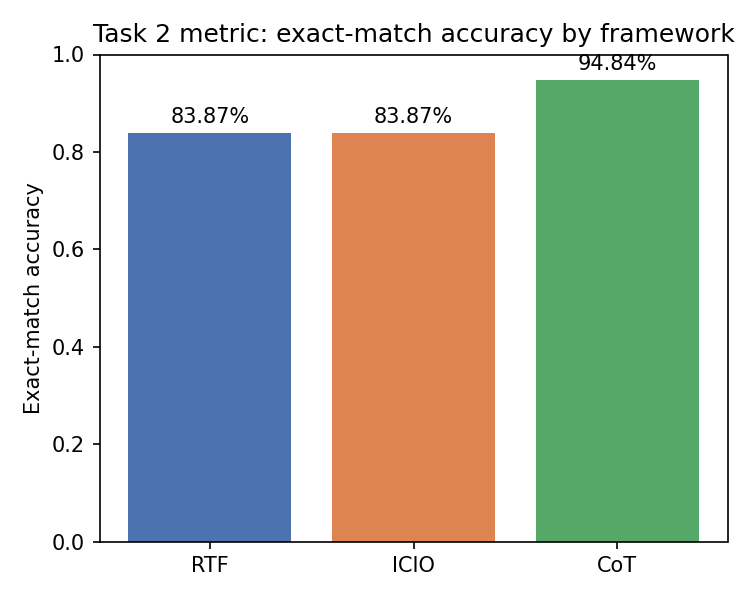
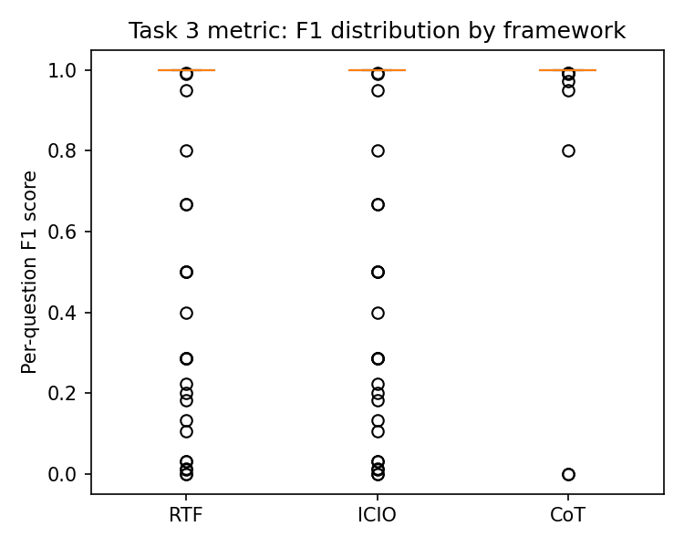
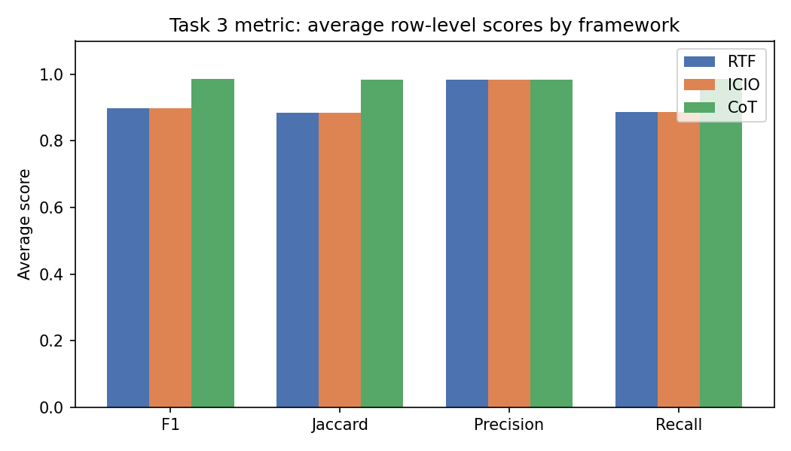
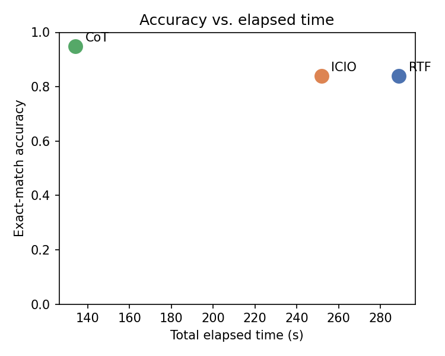

# Task 4 — Detailed Statistical Comparison of Prompting Frameworks

Frameworks compared: **RTF** (Role-Task-Format), **ICIO**
(Input-Context-Instruction-Output), **CoT** (Chain-of-Thought). All three
used the same underlying model and the same coding agent (GitHub Copilot CLI
with file read/write + bash access), on the identical 155-question
restaurant NL2SQL dataset. Full data, scripts, tables, and charts are in
`Task_4/data/`.

## 1. Summary of Results

| Framework | Exact-match Acc. | Avg F1 | Avg Jaccard | Avg Precision | Avg Recall | Time (s) |
|-----------|-------------------|--------|-------------|----------------|------------|----------|
| RTF       | 83.87% (130/155)  | 0.8970 | 0.8836      | 0.9841         | 0.8866     | 288.9    |
| ICIO      | 83.87% (130/155)  | 0.8970 | 0.8836      | 0.9841         | 0.8866     | 251.7    |
| CoT       | 94.84% (147/155)  | 0.9851 | 0.9836      | 0.9836         | 0.9871     | 134.0    |

See `accuracy_comparison.png` (Task 2 metric), `f1_boxplot.png` / `f1_bar.png`
(Task 3 metric), and `timing_vs_accuracy.png` for visualizations.

Shows the Task 2 exact-match accuracy per framework. Purpose: give the
headline pass/fail rate at a glance. It shows RTF and ICIO tied at 83.87%,
with CoT clearly ahead at 94.84% — the first visual signal that CoT's
explicit reasoning step helps.

Shows the spread (not just the average) of per-question F1 scores for each
framework. Purpose: reveal how consistent each framework is, not just its
mean. RTF/ICIO have a lower median and a long lower tail (many near-zero
scores), while CoT's box sits higher and tighter — its failures are milder,
not just fewer.

Shows average F1, Jaccard, precision, and recall side by side. Purpose:
isolate *which* part of retrieval is weak. Precision is high (~0.98) for all
three, meaning returned rows are rarely wrong — the gap is in recall
(~0.89 for RTF/ICIO vs ~0.99 for CoT), confirming the failure mode is
incomplete answers, not noisy ones.

Plots elapsed run time against accuracy per framework. Purpose: check
whether higher accuracy came at a speed cost. It shows the opposite: CoT is
both the most accurate and the fastest, so there's no speed/accuracy
trade-off in this experiment.

## 2. Statistical Significance

All 155 questions were answered by all three frameworks, so this is a
repeated-measures / paired design: **Friedman's test** (non-parametric
repeated-measures ANOVA) was used as the omnibus test on per-question F1
scores, with pairwise post-hoc **Wilcoxon signed-rank tests** (F1,
continuous) and **McNemar's tests** (exact-match, binary), both
Bonferroni-corrected for 3 comparisons.

**Friedman test** (F1, all 3 frameworks): χ² = 38.00, p < 0.0001 → at least
one framework differs significantly from the others.

**Pairwise results:**

| Comparison    | F1 (Wilcoxon)         | Exact-match (McNemar)   | Conclusion |
|---------------|------------------------|--------------------------|------------|
| RTF vs ICIO   | identical, p = 1.0000  | 0 discordant pairs, not significant | Statistically **indistinguishable** |
| RTF vs CoT    | p = 0.0004 (corrected) | p = 0.0003 (corrected)  | **Significant** |
| ICIO vs CoT   | p = 0.0004 (corrected) | p = 0.0003 (corrected)  | **Significant** |

**Conclusion:** CoT is significantly better than RTF and ICIO on both
metrics. RTF and ICIO are not just statistically similar but behaviorally
identical — correct and wrong on the exact same questions.

## 3. Why the Differences Are the Way They Are

### Prompt (the dominant factor)
CoT's structural advantage is an explicit reasoning step that forces the
model to classify each question as "needs a single best answer" vs. "needs
all matching rows" before writing SQL. RTF and ICIO have no such
disambiguation step; both defaulted to an implicit `LIMIT 1` behavior on
open/plural questions ("a restaurant in X", "restaurants near Y"), confusing
them with genuine superlative questions ("the best place in X"). This single
missing reasoning step accounts for all 25 RTF/ICIO failures (and CoT fixed
17 of those 25, leaving 8 harder partial-coverage misses on large city-wide
queries). This is a **prompt-structure effect, not a model limitation** —
the same model reasons correctly once explicitly asked to.

**Why RTF == ICIO exactly:** both frameworks are structurally "shallow"
(role/task/format vs. input/context/instruction/output) — neither contains a
reasoning or disambiguation step. Despite producing different SQL syntax
(only 1/155 predictions were textually identical), they converge on the same
underlying query logic and the same resulting rows for every single
question. This shows the *presence or absence of an explicit reasoning
instruction* — not surface wording or section layout — is what drives
outcome differences here.

### Model
The model was held constant across all three runs, so it cannot explain the
RTF/ICIO vs. CoT gap; it is controlled for by design. It is, however, the
reason CoT works at all: the model is capable of correct disambiguation, it
simply doesn't do so unless the prompt explicitly asks it to reason about
answer cardinality first. This also explains why RTF and ICIO's errors are
systematic and repeatable rather than random noise (same model, same default
behavior, same blind spot, every time).

### Coding agent
The same agent (Copilot CLI) with identical tool access ran all three
prompts, so it doesn't explain the accuracy differences. It does, however,
add I/O and tool-call overhead to the measured elapsed time — which is why
CoT could be fastest (134.0s) despite extra reasoning, while RTF (288.9s)
and ICIO (251.7s) were slower. Timing here is a rough throughput signal, not
a controlled latency benchmark.

## 4. Complementarity of the Two Metrics

Exact-match confirms CoT is better (94.84% vs 83.87%) but cannot explain how
much better the "wrong" answers were. The F1 metric adds that nuance: among
each framework's own failures, RTF/ICIO average F1 ≈ 0.36 (returned almost
nothing of what was asked) vs. CoT's ≈ 0.71 (near-complete, missing only a
few rows). The two metrics together show not just that CoT wins, but that
RTF/ICIO's mistakes are qualitatively worse, not just more frequent.

## 5. Bottom Line

The explicit reasoning step in CoT is the single largest, statistically
significant driver of accuracy improvement in this experiment. Model and
coding agent were held constant and do not explain the prompt-level
differences in correctness, though the coding agent likely explains most of
the variance in elapsed time. RTF and ICIO, despite different structures,
produced indistinguishable results — reinforcing that *what* a prompt asks
the model to reason about matters far more than *how* the prompt is
formatted or sectioned.
